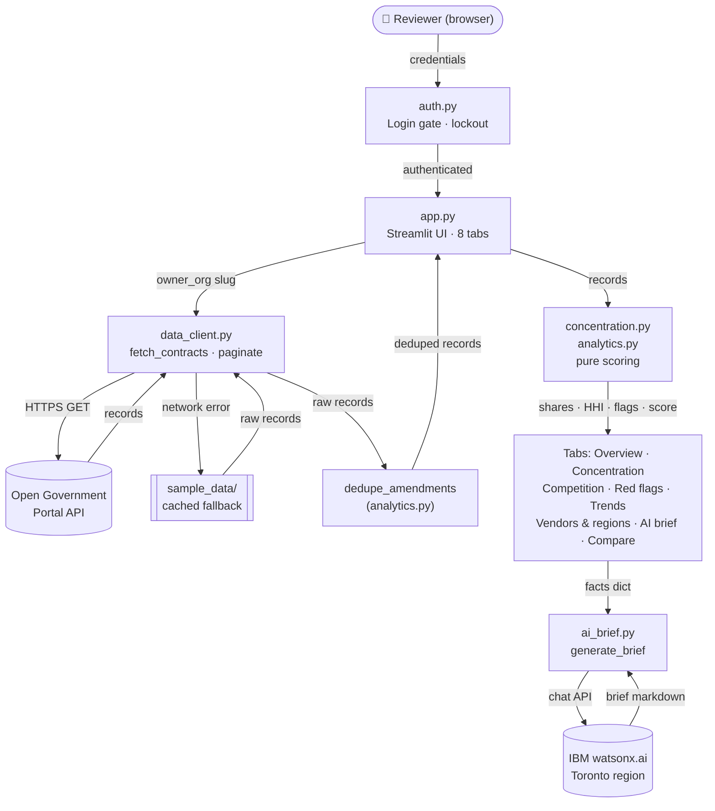

# Procurement Health Check

A Streamlit application that lets procurement auditors assess whether a Canadian federal department's contract spending is concentrated among a few vendors.

Data is pulled live from the [Canada Open Government API](https://open.canada.ca/data/en/dataset/d8f85d91-7dec-4fd1-8055-483b77225d8b) (Proactive Disclosure of Contracts, no API key required) and falls back to a bundled sample when the API is unavailable.

> **Independent tool using Government of Canada open data. Not affiliated with or endorsed by the Government of Canada. Contains information licensed under the [Open Government Licence – Canada](https://open.canada.ca/en/open-government-licence-canada).**

---

## Features

| Tab | What it shows |
|---|---|
| **Overview** | Procurement health score (0–100), 6 KPI cards, key findings |
| **Concentration** | Top-vendor Herfindahl–Hirschman Index, value-vs-count divergence |
| **Competition** | Solicitation-type breakdown, single-bid contracts |
| **Red flags** | Large amendments, split-purchase clusters, CSV export |
| **Trends** | Monthly spend and contract-count dual-axis chart |
| **Vendors & regions** | Vendor lookup, cross-department comparison, province map |
| **AI audit brief** | IBM watsonx.ai narrative brief (rule-based fallback if unconfigured) |
| **Compare departments** | Side-by-side health score, HHI and flags for all departments |

---

## Project structure

```
.
├── app.py                        # Streamlit UI only — no business logic
├── concentration.py              # Pure scoring functions (HHI, bands, flags)
├── analytics.py                  # Advanced analytics + deduplication
├── data_client.py                # API calls, pagination, cached fallback
├── auth.py                       # Login gate, lockout, sign-out
├── branding.py                   # CSS, animated logo, legal footer
├── ai_brief.py                   # watsonx.ai brief + rule-based fallback
├── requirements.txt
├── .gitignore
├── .streamlit/
│   ├── config.toml               # Enterprise theme
│   ├── secrets.toml              # ← DO NOT COMMIT (see secrets.toml.example)
│   └── secrets.toml.example      # Safe template to copy
├── sample_data/
│   ├── ssc-spc_latest1000.json   # Real SSC fallback data (1 000 raw rows)
│   └── code_labels.json          # Official solicitation/tendering/commodity labels
└── tests/
    ├── test_analytics.py         # analytics, dedup, compare_departments, bug regressions
    └── test_concentration.py     # _parse_value, normalize_vendor, vendor_shares, hhi, band, top_vendor, flags
```

---

## Local setup

### Prerequisites

- Python 3.11 or 3.12 (3.14 not supported by `ibm-watsonx-ai`)
- Git

### 1 — Clone and create a virtual environment

```bash
git clone https://github.com/your-org/procurement-health-check.git
cd procurement-health-check

python -m venv .venv
# Windows
.venv\Scripts\activate
# macOS / Linux
source .venv/bin/activate
```

### 2 — Install dependencies

```bash
pip install -r requirements.txt
```

### 3 — Configure secrets

```bash
cp .streamlit/secrets.toml.example .streamlit/secrets.toml
```

Edit `.streamlit/secrets.toml` and set a username and password.  
The `[watsonx]` section is **optional** — the app works without it and falls back to a rule-based audit brief.

### 4 — Run

```bash
streamlit run app.py
```

The app opens at `http://localhost:8501`.

---

## Running tests

```bash
pytest tests/ -v
```

All 150 tests should pass in under one second. No network access is required.

To print a coverage report:

```bash
pytest tests/ --cov=concentration --cov=analytics --cov=data_client --cov=auth --cov=branding --cov=ai_brief --cov-report=term-missing
```

---

## Deploy to Streamlit Community Cloud

1. Push your repository to GitHub (**confirm `.streamlit/secrets.toml` is in `.gitignore`** before pushing).
2. Go to [share.streamlit.io](https://share.streamlit.io) and click **New app**.
3. Select your repo, branch (`main`), and set **Main file path** to `app.py`.
4. Click **Advanced settings → Secrets** and paste the contents of your `secrets.toml` (real values, not the example).
5. Click **Deploy**. Streamlit installs `requirements.txt` automatically.

> **Python version:** in the Advanced settings panel, pin the Python version to **3.12** to ensure `ibm-watsonx-ai` installs correctly.

### Environment requirements on Streamlit Cloud

No additional system packages are needed. All dependencies are pure-Python or have pre-built wheels:

| Package | Purpose |
|---|---|
| `streamlit==1.58.0` | Web framework |
| `requests` | API calls |
| `pandas` | Data wrangling |
| `altair` | Declarative charts |
| `plotly` | Gauge and donut charts |
| `ibm-watsonx-ai` | AI brief generation |
| `pytest` | Test runner (dev only) |

---

## Secrets reference

| Key | Required | Description |
|---|---|---|
| `auth.username` | ✅ | Login username |
| `auth.password` | ✅ | Login password |
| `watsonx.api_key` | Optional | IBM Cloud API key |
| `watsonx.project_id` | Optional | watsonx.ai project ID |
| `watsonx.url` | Optional | Inference endpoint (default: `https://ca-tor.ml.cloud.ibm.com`) |
| `watsonx.model_id` | Optional | Model ID (default: `meta-llama/llama-3-3-70b-instruct`) |

---

## Data source

**Canada Open Government API** — Proactive Disclosure of Contracts  
Resource ID: `fac950c0-00d5-4ec1-a4d3-9cbebf98a305`  
Endpoint: `https://open.canada.ca/data/api/3/action/datastore_search`  
No API key required.

The API emits one row per contract amendment. The app deduplicates automatically, keeping the most recent amendment per contract (highest `reporting_period`, tie-broken by `reference_number`).

Licensed under the [Open Government Licence – Canada](https://open.canada.ca/en/open-government-licence-canada).

---

## Architecture



## Architecture notes

- **`concentration.py`** and **`analytics.py`** are pure functions — no Streamlit imports, no I/O, fully testable.
- **`data_client.py`** owns all network and file I/O. `fetch_contracts()` returns `(records, is_cached, raw_count)`.
- **`app.py`** is UI-only. It imports from the modules above but never calls the API directly.
- Deduplication (`dedupe_amendments`) runs inside `fetch_contracts` before records are returned.
- Login uses `hmac.compare_digest` to prevent timing attacks; five failed attempts trigger a 30-second lockout.
